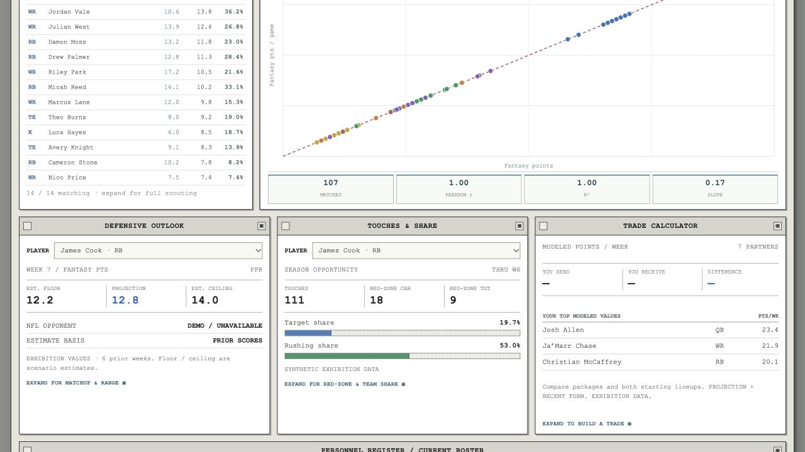
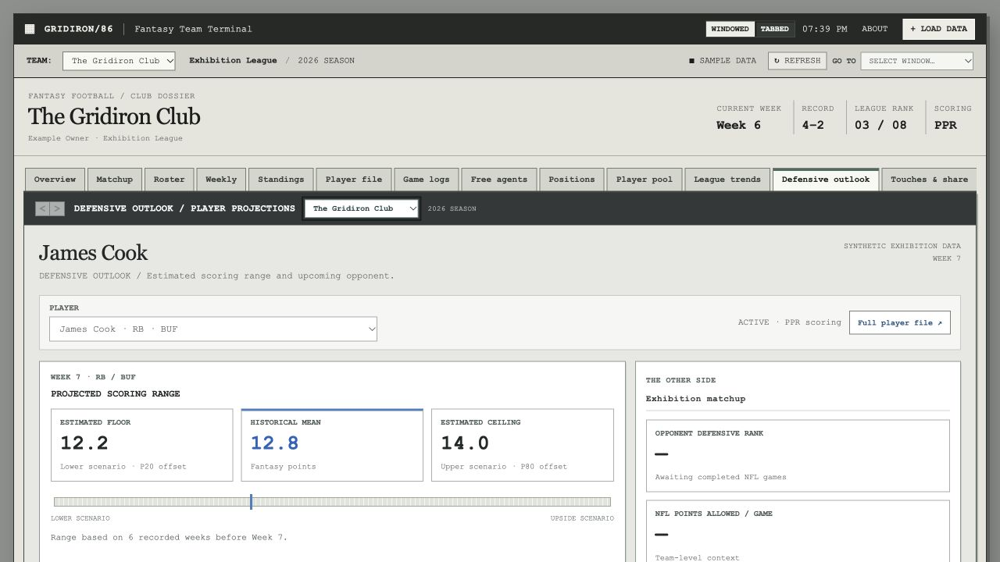

# GRIDIRON/86 9.7 verification

The original `public/style.css` is unchanged. Additions use the existing window chrome and report components.

## Automated checks

- Full JavaScript suite: 35 passing, including the Cloudflare runtime import test.
- Python opportunity aggregation suite: 5 passing.
- After the browser check, the active-tab resize fix and its regression test were added. All 14 affected navigation and strategy tests passed.
- JavaScript syntax checks and `git diff --check` passed.

## Live browser checks

Checked the deployed site using exhibition data at the default 1280px viewport and at 390px wide.

- New windows are directly below both Free Agent Wire and Variable Lab, and above Personnel Register.
- Selecting James Cook updates both home player selectors and previews; the expanded outlook opens the same player.
- Windowed reports open as dialogs. Tabbed reports appear inline, with the dashboard tiles hidden.
- Sending James Cook for Avery Knight 1 produces package and lineup differences for both teams; both selections survive changing tabs.
- Opportunity position/search filters narrow the leader table to James Cook.
- At 390px, the three windows stack, and document width equals viewport width (no page-wide horizontal overflow).
- No JavaScript console errors were observed during these interactions.

All screenshot values are synthetic exhibition data. Connected-league opportunity data comes from the published NFLverse dataset, independently of the fantasy scoring feed.
